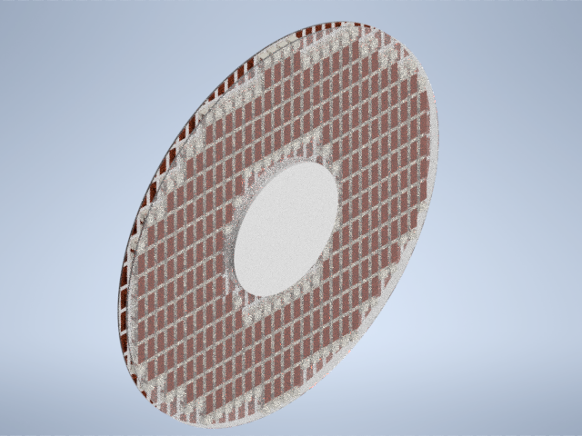
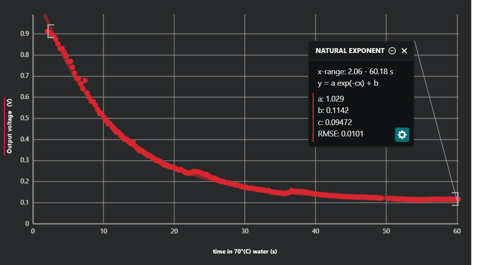
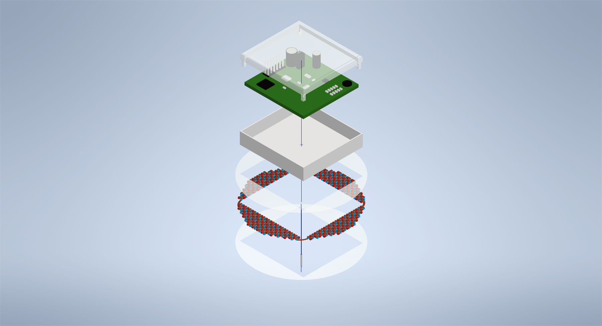

## The Problem

Continuous glucose monitors (CGMs) tell people with diabetes when to take medication and help them make diet decisions, but they run on batteries. Disposable sensors are replaced about every week, and rechargeable transmitters need charging about every three days. Every swap or recharge is a gap in data, and that hassle leads some patients to stop wearing their monitor altogether.

The sensing isn't the hard part. Power delivery is. I wanted to remove the battery from the equation by harvesting the temperature difference between the wearer's skin and the surrounding air using the **Seebeck effect**.

## Approach

Earlier research (Kim et al., 2020) paired a wearable thermoelectric bracelet with a battery. That battery needed a higher input voltage than a thermoelectric generator (TEG) provides, so the design had to step up the voltage and lost efficiency doing it. Our approach was different:

- **No battery.** Modify a commercial CGM to run at the low voltages a TEG produces.
- **Capacitor buffering.** CGMs only transmit every 5 minutes, so a capacitor can charge between readings and dump enough energy for each transmission.
- **One wearable puck.** A slim generator surrounds the CGM electronics so the whole thing stays compact and comfortable.

## Measuring the Seebeck Coefficient

To size the generator, I needed real numbers for bismuth telluride, the standard thermoelectric material. I designed an experiment using a commercial Peltier module with **127 thermocouples**: one side in 70 °C water, the other open to ~22 °C room air, logging output voltage as the module reached equilibrium.

The voltage decayed exponentially (fit: *y = a·e^(−cx) + b*). The first data point, with a known 48 K temperature difference, gave the Seebeck coefficient. The asymptote of the fit gave the steady-state temperature difference the module settles to when heat is naturally dissipated:

- **Seebeck coefficient ≈ 149.6 µV/K per thermocouple**
- **Equilibrium ΔT ≈ 6.1 K** between the hot and cold plates

This showed useful power is plausible even at the small temperature differences you get on skin.

## Design

I modeled the device in Inventor. A ring of thermocouple pairs sits under the electronics enclosure, with the PCB, storage capacitors and header in a sealed housing on top. We also selected the electronics (TI NFC and microcontroller parts) and drew the sensor-side and USB-side schematics, with bills of materials from Mouser and TI.

TODO: Add a photo of the physical prototype if one exists, and describe what the electronics actually do (NFC readout? Which TI parts?).

## Industry Review

The team presented the design for professional review. Burns & McDonnell and ABM reviewed the product in writing (letters below). Reviewers highlighted the **estimated one-year device life** and 5-minute reading interval. They suggested shrinking the form factor, adding a low-power warning, and reducing the ΔT needed to reach the driving voltage.

## What I Learned

TODO: 2-3 sentences on what you'd do differently, what you learned about thermoelectrics or low-power design, and how the project went (SkillsUSA results?).
